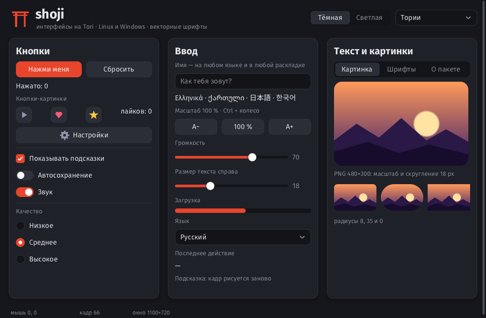

# shoji

Интерфейсы для [Tori](https://github.com/torilang): панели, кнопки, флажки, переключатели, ползунки, выпадающие списки, поля ввода, вкладки, текст векторными шрифтами, картинки PNG, скругления и мягкие тени. Масштаб под экран (100 %, 150 %, 200 %…), окна растягиваются, ввод на любом языке. Работает в Linux и Windows: всё рисуется программно в пиксели окна из `window()`, без GTK, Qt и прочих библиотек.



```bash
nest install shoji
```

```tori
use shoji

fn main() {
    ui := shoji.open("Привет", 480, 320)
    var n = 0
    var on = true
    for ui.frame() {
        ui.panel("Счётчик", 20, 20, 440, 280)
        if ui.primary("Ещё") { n += 1 }
        ui.label(shoji.cat("Нажато: ", shoji.num(n)))
        ui.toggle("Тёмная тема", &on)
        ui.end()
    }
}
```

## Витрина

```bash
cd ~/.tori/packs/shoji/preview      # Windows: %USERPROFILE%\.tori\packs\shoji\preview
tori run main.tr
```

Там все виджеты, тёмная и светлая темы, смена цвета акцента, свои шрифты (Fira Sans) и картинки. Окно можно растягивать: панели встают в три, две или одну колонку, а то, что не влезло, листается колесом. Ctrl + колесо меняет масштаб.

## Как устроено

**Immediate mode.** Каждый кадр программа заново описывает окно, а виджет сразу отвечает, что с ним сделали: `if ui.button("OK") { … }`. Колбэков и объектов-виджетов нет, состояние — твои переменные: `ui.checkbox("Звук", &sound)` сам переключает `sound`.

**Цикл.** `for ui.frame() { … }`: показывает прошлый кадр, ждёт ~1/60 с, разбирает мышь и клавиатуру и начинает новый кадр. Цикл кончается, когда окно закрыли.

**Раскладка.** Виджеты встают колонкой внутри `ui.panel(…)` / `ui.area(…)` до `ui.end()`. `ui.row(n)` ставит следующие `n` виджетов в ряд поровну по ширине.

**Масштаб.** Все координаты и размеры — в логических пикселях. На экране они умножаются на масштаб: DPI системы (в Linux — `Xft.dpi`, его ставят настройки масштаба GNOME и KDE; в Windows — системный) × зум пользователя. Зум — Ctrl + колесо, Ctrl + `=` / `-` / `0` или `ui.set_zoom(150)`. Шрифты и скругления при этом растеризуются заново под размер, а не растягиваются, поэтому остаются чёткими.

**Адаптивность.** Окно из `shoji.open` растягивается. `ui.width()` и `ui.height()` — его размер в логических пикселях, по ним раскладку можно перестраивать каждый кадр. `ui.page_height(h)` задаёт высоту страницы: если она выше окна, страница листается колесом, PgUp/PgDn и полосой справа.

**Шрифты.** Векторные TrueType и OpenType со сглаживанием: `.ttf`, `.otf` (контуры CFF) и коллекции `.ttc`. Глиф растеризуется один раз на размер и дальше берётся из кэша. Встроен Noto Sans: латиница, кириллица и основные знаки. Свой шрифт подключается через `shoji.load_font("файл.ttf")`. Если в шрифте нет символа, shoji ищет его в запасных: сначала в своих (`shoji.fallback(f)`), потом в шрифтах системы — Noto, DejaVu, WenQuanYi в Linux, Segoe UI, Microsoft YaHei, Malgun Gothic и другие в Windows. Так греческий, грузинский, армянский, иврит, тайский, китайский, японский и корейский текст виден без настройки.

**Ввод на любом языке.** Поле ввода берёт набранные символы у окна (`win.text`), уже с раскладкой: русская, немецкая, греческая и любая другая, Caps Lock, AltGr, мёртвые клавиши (´ + e = é). В Windows работают и методы ввода (IME) для китайского, японского и корейского.

**Картинки.** PNG любого типа цвета, глубина 1–16 бит, с прозрачностью; чересстрочные не поддерживаются. Масштаб билинейный, готовый размер кэшируется.

## Справочник

### Окно и кадр

| Вызов | Что делает |
| :--- | :--- |
| `shoji.open(заголовок, w, h) -> *Ui` | окно `w`×`h` логических пикселей и интерфейс к нему; окно растягивается |
| `shoji.attach(win) -> *Ui` | интерфейс к уже открытому `window()` |
| `ui.frame() -> bool` | следующий кадр; `false` — окно закрыли |
| `ui.begin()`, `ui.finish()` | то же вручную, если окон несколько и `frame()` зовёшь сам |
| `ui.dark()`, `ui.light()` | тема |
| `ui.accent(0xRRGGBB)` | цвет акцента |
| `ui.set_font(f)`, `ui.set_bold(f)` | основной шрифт и шрифт заголовков |
| `ui.th` | тема целиком (`Theme`): цвета, `radius`, `size`, `title`, `pad`, `gap`, `h` — можно менять |
| `ui.time()` | мс с открытия окна |
| `ui.width()`, `ui.height()` | размер окна в логических пикселях |
| `ui.scale()` | масштаб, %: DPI × зум |
| `ui.set_zoom(%)`, `ui.zoom` | зум пользователя (100 — как задумано, от 50 до 400) |
| `ui.page_height(h)` | высота страницы: что ниже окна, листается |
| `ui.px(v)` | логические пиксели -> пиксели экрана (для `ui.canvas()`) |
| `ui.mouse_x()`, `ui.mouse_y()`, `ui.key(KEY_…)`, `ui.held(KEY_…)` | ввод напрямую |

### Раскладка

| Вызов | Что делает |
| :--- | :--- |
| `ui.panel(заголовок, x, y, w, h)` | панель со скруглением и тенью; заголовок может быть `""` |
| `ui.area(x, y, w)` | колонка без фона |
| `ui.end()` | конец панели или колонки |
| `ui.row(n)` | следующие `n` виджетов — в ряд |
| `ui.space(px)` | отступ |
| `ui.next(h) -> Rect` | место под свой виджет высоты `h` (логические пиксели) |

### Виджеты

| Вызов | Результат |
| :--- | :--- |
| `ui.label(s)`, `ui.note(s)`, `ui.heading(s)` | текст, приглушённая подпись, заголовок |
| `ui.para(s)` | абзац с переносом по словам |
| `ui.styled(s, шрифт, размер, цвет)` | текст любым шрифтом (`null` — основной) |
| `ui.button(s) -> bool` | кнопка; `true` — нажали |
| `ui.primary(s) -> bool` | кнопка цветом акцента |
| `ui.image_button(img, s) -> bool` | кнопка с картинкой; `s == ""` — квадратная, только картинка |
| `ui.checkbox(s, &b) -> bool` | флажок; `true` — изменился |
| `ui.toggle(s, &b) -> bool` | переключатель |
| `ui.radio(s, &v, значение) -> bool` | один из вариантов |
| `ui.slider(&v, от, до) -> bool` | ползунок со значением справа |
| `ui.progress(v, max)` | полоса прогресса |
| `ui.dropdown(&v, "А\|Б\|В") -> bool` | выпадающий список; `v` — номер выбранного |
| `ui.tabs(&v, "А\|Б\|В") -> bool` | вкладки |
| `ui.input(t, подсказка) -> bool` | поле ввода на любом языке; `t := shoji.text_new("")`, текст — `t.get()` (до 255 байт UTF-8) |
| `ui.image(img, h, радиус)` | картинка высотой `h` со скруглёнными углами |
| `ui.separator()` | линия |

### Рисование напрямую

Координаты — логические, от верха страницы (с прокруткой).

| Вызов | Что делает |
| :--- | :--- |
| `ui.rect(x, y, w, h, радиус, цвет)` | скруглённый прямоугольник |
| `ui.text_at(x, y, s, шрифт, размер, цвет) -> ширина` | текст (`шрифт` — `null` для основного) |
| `ui.picture(img, x, y, w, h, радиус)` | картинка в прямоугольник |
| `ui.text_width(шрифт, размер, s)` | ширина строки в логических пикселях |
| `ui.canvas()` | холст для `shoji/draw`: `draw.poly`, `draw.line`, `draw.shadow`… — в пикселях экрана, переводи через `ui.px` |

### Шрифты, картинки, строки

| Вызов | Что делает |
| :--- | :--- |
| `shoji.load_font(путь) -> *Font` | `.ttf`, `.otf`, `.ttc` или `null` |
| `shoji.default_font()` | встроенный Noto Sans |
| `shoji.fallback(f)` | запасной шрифт для недостающих символов |
| `shoji.system_fonts(false)` | не искать недостающие символы в шрифтах системы |
| `shoji.text_width(шрифт, размер, s)` | ширина строки в пикселях экрана |
| `shoji.load_image(путь) -> *Image` | `.png` или `null`; почему — `shoji.image_error()` |
| `shoji.num(v)`, `shoji.cat(a, b)` | число в строку и склейка (строки живут несколько кадров) |

## Ограничения

* Текст выводится слева направо, без кернинга, лигатур и сборки сложных письменностей: арабские буквы не соединяются, иврит и арабский не разворачиваются справа налево, деванагари и другие индийские письменности выходят без перестановки знаков. Латиница, кириллица, греческий, армянский, грузинский, китайский, японский и корейский выглядят как надо.
* В Linux нет методов ввода (fcitx, ibus): иероглифы набираются только в Windows через IME, но показываются везде.
* Буфера обмена нет.

## Модули

| Файл | Что внутри |
| :--- | :--- |
| `src/lib.tr` | `Ui`, темы, раскладка, виджеты |
| `src/draw.tr` | холст, скругления, тени, растеризатор со сглаживанием, картинки |
| `src/font.tr` | TrueType и OpenType: `cmap` (форматы 4 и 12), `glyf` (в том числе составные глифы), CFF (Type 2), `.ttc`, запасные шрифты, кэш глифов |
| `src/png.tr` | inflate и декодер PNG |
| `src/font_data.tr` | встроенный шрифт, сгенерирован `tools/fontpack.tr` |
| `src/sys.tr` | память, файлы, отображение файлов в память |

Пересобрать встроенный шрифт из другого `.ttf`:

```bash
cd tools && tori run fontpack.tr шрифт.ttf ../src/font_data.tr
```

`fontpack` читает `/proc/self/cmdline`, поэтому работает в Linux.

## Лицензии

Код — MIT. Встроенный шрифт — подмножество Noto Sans (SIL Open Font License 1.1, [OFL-NotoSans.txt](OFL-NotoSans.txt)). Шрифты витрины Fira Sans — SIL OFL 1.1 ([preview/OFL-FiraSans.txt](preview/OFL-FiraSans.txt)).
